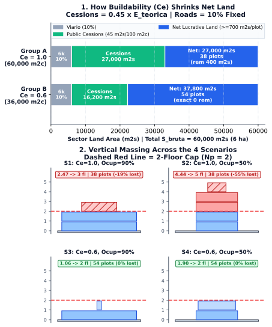
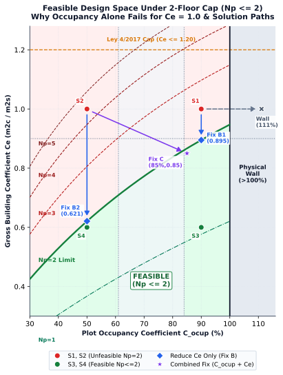
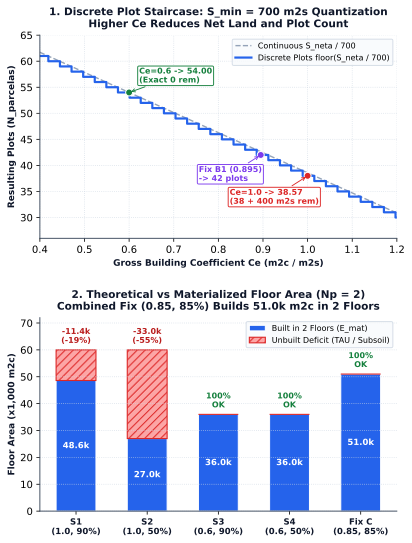

# Tarea 4 — Master Exploration Guide & Visual Reference

This document consolidates **everything discussed and built for `Tarea_4`** so you have full offline / Remote Control access inside the `Tareas/Tarea_4/` folder without needing the chat window.

---

## 1. Directory Map (`Tareas/Tarea_4/`)

| File | Purpose |
| :--- | :--- |
| **[Urban Planning Assignment Breakdown.md](./Urban%20Planning%20Assignment%20Breakdown.md)** | Step-by-step formulas, calculations for Scenarios 1–4, and analysis of the 2-floor restriction ($N_p = 2$). |
| **[input_parameters.md](./input_parameters.md)** | Table classifying all model parameters (**Fixed by Legislator** vs. **Free for Promoter**), derived variables, Ley 4/2017 bounds, and $C_e$ vs. $C_{\text{ocup}}$ definitions. |
| **[galapagos_guide.md](./galapagos_guide.md)** | Guide for running both **Galapagos** (`tarea4_galapagos.gh`) and **Octopus** (`tarea4_octopus_pareto.gh`) in Rhino 8. |
| **[urban_planning_tools.md](./urban_planning_tools.md)** | Overview of Web (TestFit, Giraffe, Forma), Desktop (Rhino/GH, QGIS, CityEngine), and Python (`ortools`, `pymoo`, `shapely`, `momepy`) urban-planning tools. |
| **[Octopus_Learning_Breakdown.md](./Octopus_Learning_Breakdown.md)** | Breakdown of the Octopus 0.4 ML examples (`01_Octopus_Supervised_SVM.gh` & `02_Octopus_Evolutionary_NEAT.gh`) and why visual programming is best reserved for 3D geometry optimization rather than 1D SVM regression. |
| **[tarea4_sector_galapagos.3dm](./tarea4_sector_galapagos.3dm)** | Rhino 8 3D model (in Meters) with the baked 2-floor optimal sector across 5 color-coded layers. |
| **[tarea4_galapagos.gh](./tarea4_galapagos.gh)** | Grasshopper definition pre-wired to built-in **Galapagos** (single-objective penalty fitness). |
| **[tarea4_octopus_pareto.gh](./tarea4_octopus_pareto.gh)** | Grasshopper definition pre-wired to **Octopus 0.4** (3 Pareto objectives + Boolean hard constraint $N_p \le 2$ + 3D phenotype mesh + 5 building typologies `Box, O, U, H, Opposed-C`). |
| **[verify_galapagos_math.py](./verify_galapagos_math.py)** | Standalone Python verification script checking the exact analytical boundary and discrete optima. |
| **[generate_exploratory_plots.py](./generate_exploratory_plots.py)** & **[build_tarea4_octopus.py](./build_tarea4_octopus.py)** | Python scripts that generate `fig1`–`fig4.svg` and `tarea4_octopus_pareto.gh`. |
| **Skill: `urban-planner`** | Saved globally at `C:\Users\tglla\.gemini\config\skills\urban-planner\SKILL.md`. |

---

## 2. Notation Note: $\text{m}^2\text{c}$ vs. $\text{m}^2\text{s}$ (Renamed from $\text{m}^2\text{t}$)

* **$\text{m}^2\text{s}$ (*metros cuadrados de suelo*):** Physical land/ground area (gross sector, roads, public cessions, net plots, horizontal footprint).
* **$\text{m}^2\text{c}$ (*metros cuadrados construidos*):** Computable enclosed & roofed built floor area across all stories.
  *(Some older Spanish planning texts write $\text{m}^2\text{t}$ for "metros cuadrados de techo", which means the exact same thing. All files, scripts, Grasshopper definitions, and SVG plots in `Tarea_4` have been standardized to **$\text{m}^2\text{c}$** to match your class notation).*

---

## 3. Visual Summary (All 4 SVG Plots)

### Figure 1 — Sector Land Mass-Balance & 4-Scenario Vertical Massing

* **Coupled land budget:** Because mandatory public cessions scale with theoretical buildability ($S_{\text{cesiones}} = 0.45 \cdot E_{\text{teórica}}$), raising $C_e$ from $0.6$ to $1.0\text{ m}^2\text{c}/\text{m}^2\text{s}$ shrinks net lucrative land from $37,800\text{ m}^2\text{s}$ ($54$ plots) down to $27,000\text{ m}^2\text{s}$ ($38$ plots).
* **Height vs. 2-floor cap:** **S3** ($1.06 \to 2$ fl) and **S4** ($1.90 \to 2$ fl) fit under $N_p = 2$. **S1** ($2.47 \to 3$ fl) and **S2** ($4.44 \to 5$ fl) exceed the cap, losing $19\%$ and $55\%$ of their buildable floor area.

### Figure 2 — Feasible Parameter Space ($C_{\text{ocup}}$ vs. $C_e$) Under $N_p \le 2$

* **Analytical hyperbolic boundary:** $C_{e,\max}(C_{\text{ocup}}) = \frac{1.8\,C_{\text{ocup}}}{1 + 0.9\,C_{\text{ocup}}}$.
* **Why occupancy alone fails at $C_e = 1.0$:** Even at the $100\%$ physical wall, $C_{e,\max}(100\%) \approx 0.947 < 1.0$ (reaching $C_e = 1.0$ in 2 floors would require an impossible $111.11\%$ occupancy).
* **Parametric fixes:** Reduce $C_e$ alone (`Fix B1`: $0.895$ at $90\%$; `Fix B2`: $0.621$ at $50\%$) or apply a **Combined Fix (`Fix C`)** such as $(85\%, 0.85)$ ($51,000\text{ m}^2\text{c}$ in $1.93 \le 2$ floors across $44$ plots).

### Figure 3 — Discrete Plot Staircase & Buildability Deficits

* **Quantization ($S_{\text{min}} = 700\text{ m}^2\text{s}$):** $C_e = 0.6$ yields an exact integer $54.00$ plots ($0\text{ m}^2\text{s}$ remainder), whereas $C_e = 1.0$ yields $38.57 \to 38$ plots ($400\text{ m}^2\text{s}$ remainder distributed among plots).

### Figure 4 — Octopus Multi-Objective Pareto Frontier & 5 Building Typologies

* **Pareto trade-off:** Traces the non-dominated curve between maximizing 2-floor floor area ($E_{\text{mat}}$, up to $53.7\text{k m}^2\text{c}$), minimizing plot coverage ($C_{\text{ocup}}$, preserving private gardens), and minimizing parcel subdivision remainder ($S_{\text{rem}}$, hitting $5\text{ m}^2\text{s}$ remainder at $43$ plots when $C_e = 0.885, C_{\text{ocup}} = 88.2\%$).

---

## 4. Courtyard Building Typologies (`Box`, `O`, `U`, `H`, `Opposed-C`)

| Shape | Consumes *Edificabilidad* ($\text{m}^2\text{c}$)? | Consumes Above-Ground *Occupancy* ($C_{\text{ocup}}$)? | Architectural Purpose |
| :--- | :---: | :---: | :--- |
| **0: Box** | Built volume only | Footprint only | Simple perimeter setback block. |
| **1: O-Block** | **No** (if open to sky) | **No** (courtyard subtracted)* | Maximizes street alignment at high $C_{\text{ocup}}$ ($70\text{–}90\%$) while giving dual-aspect daylight/ventilation. |
| **2: U-Block** | **No** | **No** | Opens the courtyard to the street/sunlight. |
| **3: H-Block** | **No** | **No** | Two wings linked by a central stair/elevator core with opposing N/S courts. |
| **4: Opposed-C (`[ ]`)** | **No** | **No** | Permeable shared central garden between two facing C-wings. |

*\*Caveats:* Roofing an **O** courtyard with glass makes it count toward $\text{m}^2\text{c}$; excavating underground parking beneath the courtyard counts toward **subterranean occupancy** (*ocupación bajo rasante*).

---

## 5. Optimization Tooling Summary (Galapagos vs. Octopus vs. Python)

1. **Where Built-in Galapagos Lives in Rhino 8:**
   * Bundled natively with Grasshopper at `C:\Program Files\Rhino 8\Plug-ins\Grasshopper\Components\GalapagosComponents.gha` (Ribbon: **`Params` $\to$ `Util` $\to$ `Galapagos`**).
   * Single-objective only: requires penalty weights (`tarea4_galapagos.gh`).
2. **Where Octopus 0.4 Lives in Rhino 8:**
   * Installed and unblocked in `C:\Users\tglla\AppData\Roaming\Grasshopper\Libraries\` (`Octopus.gha`, `HelixToolkit.Wpf.dll`, `encog-octopus.dll`, `sharpNeatLib-octopus.dll`; Ribbon: **`Params` $\to$ `Util` $\to$ `Octopus`**).
   * Modeled on `02_twoObjectivesAndHardConstraint.gh` in **[tarea4_octopus_pareto.gh](./tarea4_octopus_pareto.gh)**: uses a native **Boolean Hard Constraint** (`Np<=2 Valid = True/False`), **3 Pareto Objectives** (`-E_mat`, `C_ocup%`, `Remainder`), and a **3D Sector Phenotype Mesh** (`SectorMesh`).
