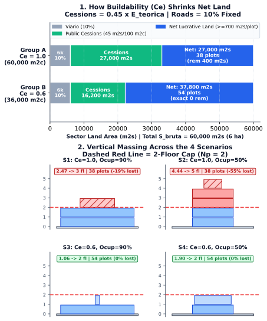
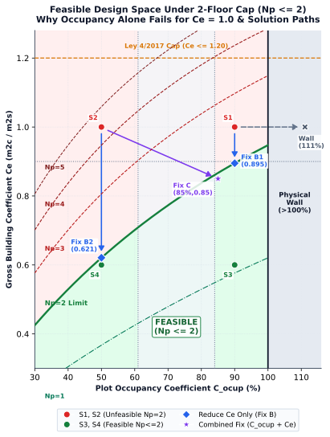
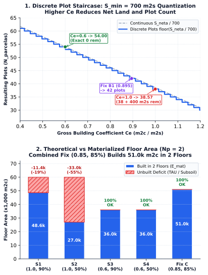

[&larr; Draft Index](index.md) · [Next: Ch. 2 Legal Realities &rarr;](sec2_legal_realities.md)

# 1. Statutory Model & Two-Floor Efficiency Frontier

---

## 1.1 Sector Parameters & International Zoning Terminology

For a residential urbanizable sector derived from student identifier digit `4` (`S_bruta = (4 + 2) ha = 60,000 m2s`), the planning brief separates **land area** ($\text{m}^2_s$, *suelo*) from **built residential floor area** ($\text{m}^2_c$, *techo construido*):

| Parameter / Ratio | International Zoning Term | Spanish Statutory Equivalent | Value / Formula |
| :--- | :--- | :--- | :--- |
| **Gross Sector Area** | Gross site area ($S_{\text{bruta}}$) | *Superficie bruta del sector* | `60,000 m2s` (`6 ha`) |
| **Public Road Network** | Street & road cession ($S_{\text{viario}}$) | *Viario público a ceder* | `10%` (`6,000 m2s`) |
| **EL / D / I Cessions** | Open space & public facilities ($S_{\text{cesiones}}$) | *Cesiones dotacionales* | `0.45 m2s / m2c` (`45 m2s / 100 m2c`) |
| **Minimum Net Plot** | Minimum parcel size ($S_{\min}$) | *Parcela mínima* | `700 m2s` |
| **Gross FAR** | **Gross Floor Area Ratio** ($C_e$) | *Edificabilidad bruta* | $C_e = E_{\text{teórica}} / S_{\text{bruta}}$ (`0.6` or `1.0`) |
| **BCR / Lot Coverage** | **Building Coverage Ratio** ($C_{\text{ocup}}$) | *Ocupación de parcela* | $\text{BCR} = S_{\text{footprint}} / S_{\text{neta}}$ (`50%` or `90%`) |
| **Net FAR** | **Net Floor Area Ratio** ($e_{\text{neta}}$) | *Edificabilidad neta* | $E_{\text{teórica}} / S_{\text{neta}} = \text{BCR} \cdot N_p$ |

---

## 1.2 Scenarios S1–S4 & Two-Floor Height Deficits

Public cessions scale linearly with theoretical buildability ($S_{\text{cesiones}} = 0.45 \cdot E_{\text{teórica}}$), tightening net buildable land ($S_{\text{neta}} = S_{\text{bruta}} - S_{\text{viario}} - S_{\text{cesiones}}$) whenever `Gross FAR` rises:

| Metric | Scenario 1 | Scenario 2 | Scenario 3 | Scenario 4 |
| :--- | :---: | :---: | :---: | :---: |
| **`Gross FAR` ($C_e$)** | `1.0` | `1.0` | `0.6` | `0.6` |
| **`BCR` (Lot Coverage)** | `90%` | `50%` | `90%` | `50%` |
| **Theoretical Floor Area ($E_{\text{teórica}}$)** | `60,000 m2c` | `60,000 m2c` | `36,000 m2c` | `36,000 m2c` |
| **Public Cessions (`0.45 * E`)** | `27,000 m2s` | `27,000 m2s` | `16,200 m2s` | `16,200 m2s` |
| **Net Buildable Land ($S_{\text{neta}}$)** | `27,000 m2s` | `27,000 m2s` | `37,800 m2s` | `37,800 m2s` |
| **Resulting Plots ($\lfloor S_{\text{neta}} / 700 \rfloor$)** | **`38`** | **`38`** | **`54`** | **`54`** |
| **Required Stories ($N_{\text{plantas}}$)** | `2.47 -> 3` | `4.44 -> 5` | `1.06 -> 2` | `1.90 -> 2` |
| **Deficit Under `2-Floor` Cap** | **`-19%` (`11,400 m2c`)** | **`-55%` (`33,000 m2c`)** | `0%` (`Feasible`) | `0%` (`Feasible`) |

> **Side Jump &rarr; Legal Outlets for Unbuilt Floor Area:** Why can non-computable basement parking *not* absorb the `11,400 m2c` / `33,000 m2c` deficits, whereas `TAU` transfers and habitable *bajo cubierta* lofts can? [**Jump to §2.1 Legal Outlets &rarr;**](sec2_legal_realities.md#sub2_1)

---

## 1.3 The Two-Floor Pareto Efficiency Frontier

Imposing a binding 2-story cap ($E_{\text{teórica}} \le 2 \cdot S_{\text{neta}} \cdot \text{BCR}$) yields a closed-form Pareto efficiency frontier (in the sense formalized by **Arrow & Debreu, 1954**, where no floor area can be gained without either raising lot coverage or trading away plot count):

$$\text{Gross FAR}_{\max}(\text{BCR}) = \frac{1.8\,\text{BCR}}{1 + 0.9\,\text{BCR}}, \qquad E_{\text{teórica}}(\text{BCR}) = \frac{108{,}000\,\text{BCR}}{1 + 0.9\,\text{BCR}}$$

- **Impossibility of `Gross FAR = 1.0`:** Reaching `60,000 m2c` in two stories requires $\text{BCR} = \frac{60{,}000}{2 \times 27{,}000} = 111.11\% > 100\%$.
- **Minimum Threshold for `Gross FAR > 0.90`:** Even crossing `0.90` demands $\text{BCR} > 90.91\%$, leaving under `10%` of each plot unbuilt; even `100% BCR` caps at `Gross FAR = 0.9474` (`56,842 m2c`, `40` plots).
- **Urbanistic Benchmark (`BCR = 90%`):** Preserving minimal setbacks/patios caps physical 2-floor output at **`Gross FAR = 0.8950`** (`53,702 m2c`, **`42` plots**).

> **Side Jump &rarr; Physical Yield vs. Market Peak:** Reaching the boundary `Gross FAR = 0.895` maximizes concrete volume (`m2c`), not developer net margin. [**Jump to §3.1 Market Risk–Efficiency Peak &rarr;**](sec3_market_economics.md#sub3_1)

---

[&larr; Draft Index](index.md) · [Next: Chapter 2 — Canary Islands Urban Law & Scale Realities &rarr;](sec2_legal_realities.md)
