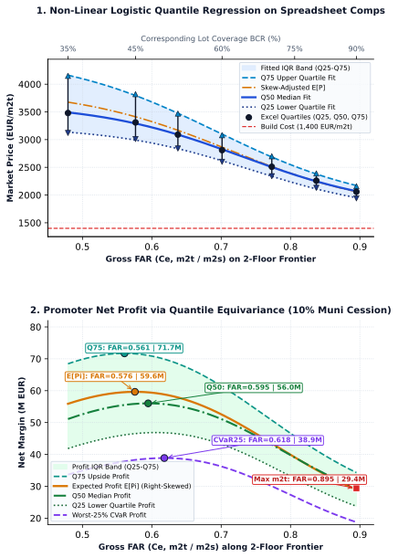
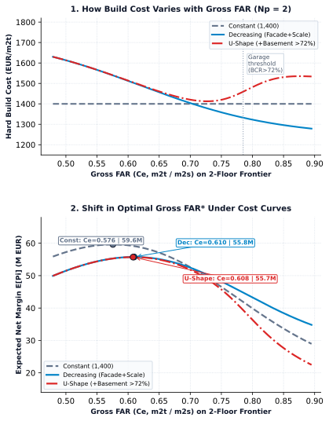

[&larr; Ch. 2 Legal Realities](sec2_legal_realities.md) · [Draft Index](index.md) · [Next: Ch. 4 Affordability & VPO &rarr;](sec4_mixed_vpo_synthesis.md)

# 3. Market Valuation, Cost Physics & Risk–Return Frontier

---

## 3.1 Market Price Quartiles, Skewness & the Risk–Efficiency Peak

Rather than imposing artificial Gaussian noise around average prices, market uncertainty is modeled directly from **tabulated price quartiles (`Q25`, `Q50`, `Q75`)** across seven density cohorts along the 2-floor frontier (`BCR = 35%` to `90%`, corresponding to `Gross FAR = 0.479` to `0.895`).

- **Asymmetric Dispersion (Bowley Skew):** Low-density detached villas (`BCR = 35%–45%`) command wide upside spreads (`Q25 = 3,120`, `Q50 = 3,480`, `Q75 = 4,150 EUR/m2c`), whereas high-density row units (`BCR = 90%`) compress tightly near commodity ceilings (`Q25 = 1,940`, `Q50 = 2,060`, `Q75 = 2,160 EUR/m2c`).
- **Exact Profit Quantiles:** Because promoter net margin $\Pi$ increases linearly with unit sales price $P$, the quartiles of market price map cleanly to exact profit quartiles without simulation distortion.
- **Risk–Efficiency Trade-off (Markowitz, 1952):** Just as efficient capital allocation balances expected return against downside risk, maximizing **expected margin $E[\Pi]$** shifts density **lower** than maximizing median profit $Q_{50}$ or protecting worst-quartile tail risk ($\text{CVaR}_{25}$):

| Optimization Criterion | Optimal `Gross FAR*` | Optimal `BCR*` | Net Margin (`M EUR`) | Economic Interpretation |
| :--- | :---: | :---: | :---: | :--- |
| **$\text{CVaR}_{25}$ (Downside Protection)** | `0.6180` | `49.7%` | `38.87M` | Shifts toward volume to cushion bear-market price drops |
| **$Q_{25}$ (Lower Quartile)** | `0.6055` | `48.2%` | `46.87M` | Cautious baseline valuation |
| **$Q_{50}$ (Median Market)** | `0.5947` | `47.0%` | `56.02M` | Symmetric median pricing peak |
| **$E[\Pi]$ (Skew-Adjusted Expectation)** | `0.5756` | `44.9%` | `59.64M` | Luxury upside skew pulls density lower (`~45% BCR`) |
| **$Q_{75}$ (Upper Quartile Tail)** | `0.5606` | `43.3%` | `71.70M` | Captures detached villa scarcity premium |

*(Note: Under constant baseline `1,400 EUR/m2c` hard build cost; statutory maximum `Gross FAR = 0.895` yields sharply lower margin due to steep price compression.)*

---

## 3.2 Physical Construction Cost Economies & Underground Garage Inflection

Unit construction cost (`EUR/m2c`) is **not constant** across density — it follows a **U-shaped physical curve** driven by building geometry and mandatory parking limits (`>= 1` stall/dwelling):

1. **Declining Envelope & Scale Phase (`BCR = 35% -> 70%`):** Shifting from 4-facade detached luxury villas (pools, bespoke glazing, scattered site mobilization) to attached party-wall townhouses (*pareados* / *adosados*) cuts exterior envelope area per $\text{m}^2_c$ and standardizes finishes.
2. **Upward Underground Garage Inflection (`BCR > 70%–72%` or `Np >= 3`):** Once plot coverage exceeds `~70%`, the remaining unbuilt yard cannot accommodate driveways and grade-level parking stalls, forcing **excavated underground garages (`+250 EUR/m2c`)** with retaining walls and mechanical ventilation.

| Hard Cost Assumption | Optimal `Gross FAR*` ($E[\Pi]$) | Optimal `BCR*` | Hard Cost at Peak | Peak $E[\Pi]$ | Margin at `0.895` |
| :--- | :---: | :---: | :---: | :---: | :---: |
| **Constant (`1,400 EUR/m2c`)** | `0.576` | `44.9%` | `1,400 EUR/m2c` | `59.64M` | `28.95M` |
| **Decreasing (Envelope + Scale)** | `0.610` | `48.7%` | `1,502 EUR/m2c` | `55.77M` | `34.81M` |
| **Unified U-Shape (`+Garage >72%`)** | `0.608` | `48.5%` | `1,505 EUR/m2c` | `55.72M` | `22.48M` |

> **Side Jump &rarr; Garage Surcharge on Compact Social Housing:** Applying this same physical threshold to social housing triggers underground garage costs whenever VPO blocks compact above `70% BCR` or rise to 5-floor towers. [**Jump to §4.2 Unified VPO Comparison &rarr;**](sec4_mixed_vpo_synthesis.md#sub4_2)

---

## 3.3 Expert Market Sensitivity Expectations

Where empirical comparables are sparse or absent at intermediate densities, experienced analysts rarely rely on raw data points alone — they incorporate **structural expectations of price levels and local sensitivities** ($\partial P / \partial \text{FAR}$):

- **Baseline Market Curve:** Encodes seasoned valuation judgment (upper villa ceiling, commodity floor, and transition pace).
- **Marginal Sensitivity Anchors:** Practitioner estimates such as *"raising `Gross FAR` by `+0.10` around `0.60` trims selling prices by `~450 EUR/m2c`"* or *"price erosion flattens above `85% BCR`"* tighten predictions smoothly between observed comparables without inventing arbitrary uncertainty bands.

---

[&larr; Ch. 2 Legal Realities](sec2_legal_realities.md) · [Draft Index](index.md) · [Next: Chapter 4 — Mixed 40% VPO & Affordability Synthesis &rarr;](sec4_mixed_vpo_synthesis.md)
