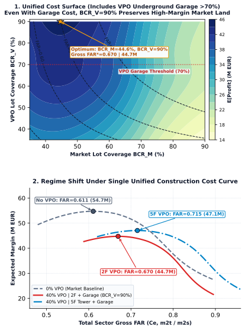

[&larr; Ch. 3 Market Economics](sec3_market_economics.md) · [Draft Index](index.md)

# 4. Mixed `40% VPO` Reserve & Affordability Synthesis

---

## 4.1 Statutory VPO Budget on Buildable Area ($\text{m}^2_c$) & Decoupled Coverages

As established in **`Tarea_3`**, statutory protected housing (`VPO`) reserves (**`40%`** baseline in **RDL 7/2015 Art. 20.1.b**; **`>= 30%`** regional floor in **Ley 4/2017 Art. 138**) apply strictly to **total residential buildable area ($E_{\text{teórica}}$ in $\text{m}^2_c$)**, **not** net land area ($S_{\text{neta}}$):

- **Total Sector Allocation (`40% VPO / 60% Market`):** Comprises **`10%`** Municipal PMS land (see [§2.2 Municipal Cession](sec2_legal_realities.md#sub2_2)) plus **`30%`** private promoter VPO, leaving **`60%`** free-market housing.
- **Expansion from 2D to 3D Choice Space:** Separating free-market lot coverage ($\text{BCR}_M$) from social-housing lot coverage ($\text{BCR}_V$) yields a decoupled feasibility frontier linking total `Gross FAR` to both typologies:

$$\text{Gross FAR}_{\max}(\text{BCR}_M, \text{BCR}_V) = \frac{0.90}{0.45 + \frac{0.60}{2\,\text{BCR}_M} + \frac{0.40}{N_{p,V}\,\text{BCR}_V}}$$

---

## 4.2 Two-Floor VPO (`90% BCR`) vs. Five-Floor Collective VPO Towers (`Tarea_3`)

To avoid inconsistent cost assumptions across typologies, **both Market and VPO zones share a single unified physical construction cost model** accounting for envelope compactness ($\text{Net FAR} = N_p \cdot \text{BCR}$), elevator/structural cores for $N_p \ge 3$, finish grade (luxury Market spec vs. regulated VPO module spec at a `1,680 EUR/m2c` sale cap), and **common underground garages (`+250 EUR/m2c`)** triggered whenever $\text{BCR} > 70\%$ or collective height $N_p \ge 3$ (see [§3.2 Garage Threshold](sec3_market_economics.md#sub3_2)):

| Policy Regime (`Unified Cost`) | `Gross FAR*` | `BCR_M*` | `BCR_V*` (`NpV`) | Build Cost (`Mkt / VPO`) | Land Split (`Mkt / VPO`) | Peak $E[\Pi]$ |
| :--- | :---: | :---: | :---: | :---: | :---: | :---: |
| **`0%` VPO Baseline (100% Market)** | `0.6106` | `48.8%` | — | `1,533 / — EUR/m2c` | `33,763 / 0 m2s` | **`54.72M`** |
| **`40%` VPO Strict `Np <= 2` Both** | `0.6696` | `44.6%` | `90.0%` (`2F`) | `1,574 / 1,417 EUR/m2c` | `26,994 / 8,928 m2s` | **`44.75M`** |
| **`40%` VPO `Tarea_3` 5-Floor Towers** | `0.7152` | `45.3%` | `55.0%` (`5F`) | `1,568 / 1,462 EUR/m2c` | `28,448 / 6,242 m2s` | **`47.06M`** |

### Strategic Takeaways for the Juridical Brief
1. **Why `BCR_V` Pushes to `90%` Even With Underground Garages:** Regulated VPO pricing cannot capture low-density garden premiums. Even though compacting VPO above `70% BCR` triggers a `+250 EUR/m2c` underground garage surcharge, paying that garage cost protects over twice as much margin by preserving `~45% BCR` low-density luxury market villas on the remaining land.
2. **Counter-Intuitive Rise in Optimal `Gross FAR`:** Rather than shrinking optimal sector density, mandatory VPO shifts total **`Gross FAR*` upward (`0.611 -> 0.670`)** — or **`0.715`** when `Plan Parcial` flexibility permits `Tarea_3`-style **5-story VPO towers** with shared communal gardens and common subterranean parking (`+2.31M EUR` recovery over strict 2-floor VPO).

---

[&larr; Ch. 3 Market Economics](sec3_market_economics.md) · [Back to Draft Index](index.md)
