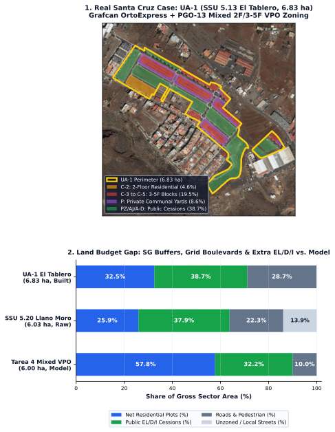

[&larr; Ch. 4 Mixed 40% VPO Synthesis](sec4_mixed_vpo_synthesis.md) · [Draft Index](index.md)

# 5. Closing Synthesis: Theory vs. Santa Cruz Reality

---

## 5.1 Why `10%` Ideal Roads and Textbook `EL/D/I` Fall Short (`El Tablero` & `Llano del Moro`)

Comparing our idealized `6.00 ha` model against two official Distrito Suroeste cases in the **Santa Cruz de Tenerife PGO (`140613-pgo-sct`)** demonstrates how real urban plans diverge from textbook ratios — and confirms that `Tarea_4`'s `10%` street allowance and local-only `0.45 m2s/m2c` cession rule regularly understate real public land consumption:

| Land Allocation (`%` of Gross Sector) | `Tarea_4` Mixed Model (`6.00 ha`) | `UA-1` *El Tablero* (`6.83 ha`, Built Roads) | `SSU 5.20` *Llano del Moro 3* (`6.03 ha`, Raw) |
| :--- | :---: | :---: | :---: |
| **Gross Sector Area ($S_{\text{bruta}}$)** | `60,000 m2s` (`FAR 0.715`) | `68,337 m2s` (`FAR 0.70`) | `60,263 m2s` (`FAR 0.60`) |
| **Net Residential Plots ($S_{\text{neta}}$)** | **`57.8%`** | **`32.5%`** (`22,240 m2s`) | **`25.9%`** (`15,662 m2s`) |
| **Public `EL/D/I` & Parks** | **`32.2%`** (`SL` only) | **`39.6%`** (`27,049 m2s`) | **`37.9%`** (`22,809 m2s`) |
| **Roads & Pedestrian Boulevards** | **`10.0%`** | **`27.9%`** (`19,048 m2s`) | **`22.3%`** (`13,385 m2s` + unmapped `13.9%`) |
| **VPO Share & Municipal Cession** | `40%` (`10%` PMS + `30%`) | `71%` sector VPO (`94%` of `UA-1` land) | `35%` VPO (`10%` PMS explicitly on `VP`) |

### What Actually Causes the `~25%–32%` Net-Land Shrinkage
Measured terrain slopes across both mesas are moderate (`1.0%–9.5%` in `UA-1`; `0.2%–12.1%` in `SSU 5.20`), so terrain grade is **not** the primary driver. Instead, three planning mechanisms explain why `10%` roads and minimum `EL/D/I` fall short in practice:

1. **Isolated-Plateau Deficit Compensation & Cliff-Edge Buffers:** Perched at `~380–400 m` elevation on the plateau edge (*"El Tablero"* = tabletop) above *Barranco del Chorrillo*, the dense older neighborhood (*Calle Los Brezos* / *Palo Blanco*) lacks internal parks or plazas. Because residents cannot walk to downtown amenities, `SSU 5.13` must supply **`43,734 m2s` (`27,049 m2s` inside `UA-1`)** vs. only `32,311 m2s` (`19,084 m2s`) legal minimum (`+35%` extra) — placing school (`DOC`), sports (`DEP`), and large plazas (`PZ`), while converting the steep southern *barranco* cliff rim into landscaped greenbelt (`AJ`, `9,621 m2s`).
2. **City-Wide *Sistemas Generales* (`SG` / `SGV`) Embedded Inside Sectors:** `SSU 5.20` (`6.03 ha`, within `0.44%` of `Tarea_4`) absorbs **`8,967 m2s` (`14.9%`)** of city-wide *Sistema General Parque Urbano* plus the *Autovía Exterior* and `Calle Zapatera` arterial frontage (`14.2% SGV`). Textbook `0.45 m2s/m2c` calculations count *Sistemas Locales* only.
3. **Closed-Block Grids & Pedestrian Boulevards:** Real *manzana cerrada* grids (`C-2`, `C-3..C-5`) require fine internal streets (`17.7%` in `UA-1`) plus dedicated pedestrian promenades (`10.2%` `PS`), roughly tripling our stylized `10%` street assumption.

### Connection to the Prior Santa Cruz PGO Audit (`SSU 5.13` Case Study #1)
- In the municipal FIP audit (`QGIS-testing`, *Actuación 1*), `SSU 5.13` (`UA-1`, `UA-2`, `UA-3`, `112,021 m2s`, `80,778 m2c`) constituted the municipality's **only** *Suelo Urbanizable Sectorizado* (`SUS`) residential expansion.
- The PGO specifically carved out **`UA-1` (`6.83 ha`, private execution)** from fragmented minority holdings (`UA-2` `2.75 ha`, `UA-3` `1.62 ha`, public cooperation) so consolidated landowners could advance urbanization.
- Yet **judicial annulment of the 2013 PGO (`TSJC 116/2014`)**, precautionary suspension of the 2022 Provisional Ordinance (**`TSJC 000070/2023`**), and expired **`2015–2023`** statutory execution deadlines left even **`UA-1`'s already-paved `C-2` (`3,110 m2s`) and collective `C-3..C-5` plots sitting as bare dirt more than a decade later**.

---

## 5.2 Cross-Platform Visual Proof (`Grafcan OrtoExpress` vs. Google Earth 3D)

Superimposing official PGO-13 zoning (`EDIF` / `GES`) onto two independent remote-sensing sources confirms exact geometric agreement across the plateau, built streets, plazas, *Colegio El Tablero* school/pitch, and the unbuilt dirt plots:

- **Exact Alignment on the Mesa:** On both images, the paved boulevards, trees, and sidewalks of `UA-1` (`yellow` boundary) frame empty dirt development blocks zoned for `C-2` (2-floor residential, **`amber`**, bottom-left next to built courtyard homes) and `C-3..C-5` (`red` + `purple` private courtyards `P`), bordered by green `PZ`/`AJ` cessions hugging the *Barranco del Chorrillo* cliff edge on the lower right.

---

[&larr; Ch. 4 Mixed 40% VPO Synthesis](sec4_mixed_vpo_synthesis.md) · [Back to Draft Index](index.md)
